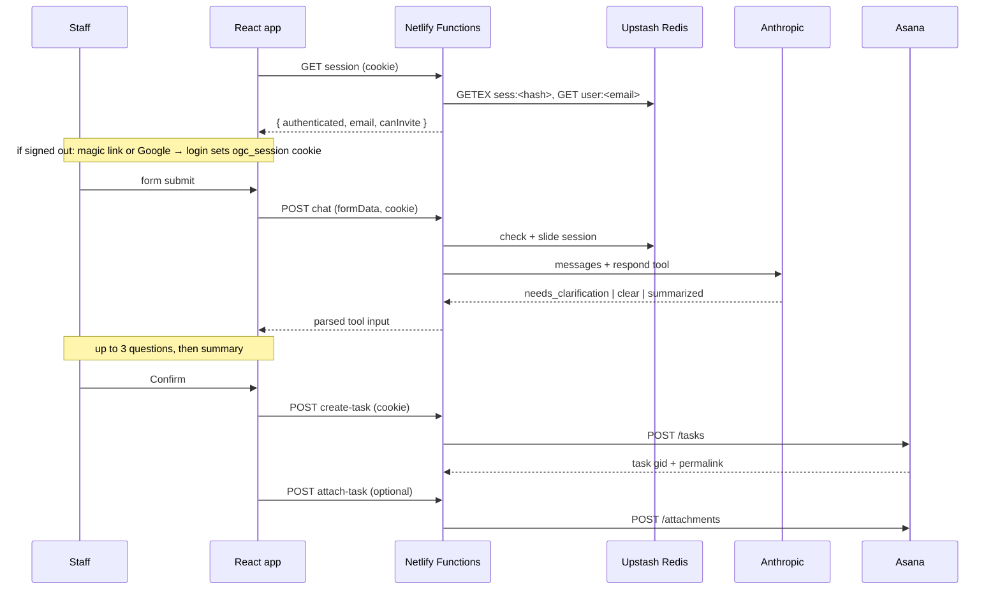

React SPA on Netlify. Netlify Functions hold every credential: three for the
request flow and six for accounts and sign-in. Upstash Redis stores accounts and
sessions. The browser never sees an API key, and its session is an `HttpOnly`
cookie that page scripts can't read.

## Request path

## The stage machine

`App.jsx` runs a `useReducer` over six stages:

| Stage | Meaning | Form editable? |
|---|---|---|
| `FORM` | Initial / after edit | Yes |
| `SUBMITTING` | Form sent, waiting on Philip's first reply | No |
| `CLARIFYING` | Philip is asking questions | No |
| `SUMMARY` | Summary shown, awaiting confirm | No |
| `SUCCESS` | Task created | — |
| `ERROR` | Something failed | Yes |

Editability is a **positive allowlist** (`FORM` or `ERROR`) rather than a
denylist, so any stage added later is frozen by default instead of silently
editable.

Authentication sits outside the reducer as `session` state (`undefined` while
loading, `null` when signed out, else `{ email, canInvite }`). It's a gate, not a
stage. Keeping it outside the reducer means a 401 can drop the user to the
sign-in screen while the reducer keeps their in-progress request for after they
sign in again.

## Loop controls

Two constants bound the AI conversation:

- **`MAX_Q = 3`** — after three questions, `runPhilip` stops asking and forces
  summarization regardless of what Philip returns.
- **`MAX_CLEAR_DEPTH = 2`** — `requestSummary()` calls back into `runPhilip`
  recursively. Without the depth cap, a model that kept returning `clear`
  instead of `summarized` would recurse indefinitely.

## Re-entrancy guards

`philipInFlight` and `confirmInFlight` are **refs, not state**. State updates
aren't visible within the same tick, so a state-based guard wouldn't stop a
double-click from firing two `createTask` calls. The refs are set synchronously
before the `await` and cleared in `finally`.

## Attachment ordering

The task is created first; the attachment is uploaded second. An attachment
failure is caught and surfaced as a **non-fatal warning** on the success screen
rather than an error — because the task already exists, and showing an error
would invite a resubmit and a duplicate task.

## Design decisions

<AccordionGroup>
  <Accordion title="Why Netlify Functions instead of calling APIs from the browser?">
    Both the Asana PAT and the Anthropic key are workspace/account-scoped
    secrets. Anything in the client bundle is public. The functions are thin
    proxies whose only job is holding those credentials and validating input.
  </Accordion>
  <Accordion title="Why invite-only individual accounts, and why Redis?">
    The app first used one shared passphrase. That couldn't revoke one person
    without changing it for everyone, couldn't tell who was signed in, and
    leaked to anyone a staff member forwarded it to. Individual accounts fix
    all three. They are invite-only because the audience is a small, known
    group, so nobody needs to sign up on their own. They are passwordless
    (email link or Google), so there are no passwords to store, reset, or
    reuse.

    Upstash Redis was already there for rate limiting. Its key TTLs cover what
    auth needs: expiring invites, one-time links, and a sliding 30-minute
    session. It adds no new service, no schema, and no cron job for cleanup.
    See [Authentication](/architecture/authentication).
  </Accordion>
  <Accordion title="Why bake the roster in at build time?">
    Covered fully in [Roster](/architecture/roster) — the short version is zero
    runtime latency, no Notion outage in the hot path, and no personal data in
    the repo.
  </Accordion>
  <Accordion title="Why does Philip use a tool call instead of returning JSON?">
    Parsing JSON out of prose is unreliable — the model wraps it in code fences,
    adds preamble, or drifts from the shape. A forced `tool_choice` gives a
    schema-validated object every time. See [Functions](/architecture/functions).
  </Accordion>
</AccordionGroup>
