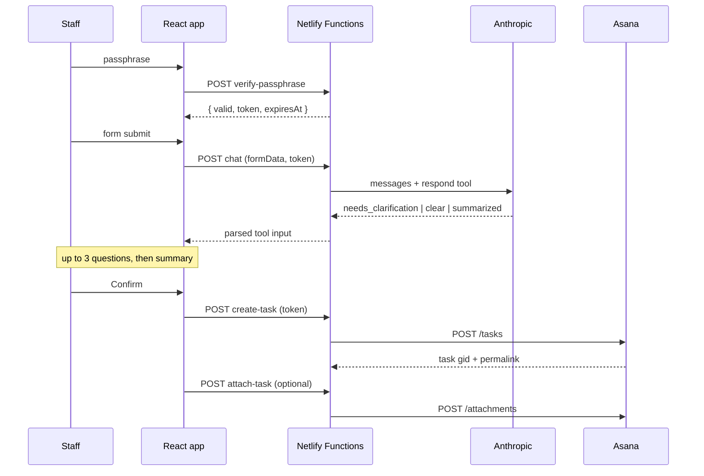

React SPA on Netlify, with four Netlify Functions holding every credential. The
browser never sees a token, a key, or the passphrase itself.

## Request path

## The stage machine

`App.jsx` runs a `useReducer` over six stages:

| Stage | Meaning | Form editable? |
|---|---|---|
| `FORM` | Initial / after edit | Yes |
| `SUBMITTING` | Form sent, waiting on Philip's first reply | No |
| `CLARIFYING` | Philip is asking questions | No |
| `SUMMARY` | Summary shown, awaiting confirm | No |
| `SUCCESS` | Task created | — |
| `ERROR` | Something failed | Yes |

Editability is a **positive allowlist** (`FORM` or `ERROR`) rather than a
denylist, so any stage added later is frozen by default instead of silently
editable.

Authentication sits outside the reducer as a single `authenticated` boolean —
it's a gate, not a stage.

## Loop controls

Two constants bound the AI conversation:

- **`MAX_Q = 3`** — after three questions, `runPhilip` stops asking and forces
  summarization regardless of what Philip returns.
- **`MAX_CLEAR_DEPTH = 2`** — `requestSummary()` calls back into `runPhilip`
  recursively. Without the depth cap, a model that kept returning `clear`
  instead of `summarized` would recurse indefinitely.

## Re-entrancy guards

`philipInFlight` and `confirmInFlight` are **refs, not state**. State updates
aren't visible within the same tick, so a state-based guard wouldn't stop a
double-click from firing two `createTask` calls. The refs are set synchronously
before the `await` and cleared in `finally`.

## Attachment ordering

The task is created first; the attachment is uploaded second. An attachment
failure is caught and surfaced as a **non-fatal warning** on the success screen
rather than an error — because the task already exists, and showing an error
would invite a resubmit and a duplicate task.

## Design decisions

<AccordionGroup>
  <Accordion title="Why Netlify Functions instead of calling APIs from the browser?">
    Both the Asana PAT and the Anthropic key are workspace/account-scoped
    secrets. Anything in the client bundle is public. The functions are thin
    proxies whose only job is holding those credentials and validating input.
  </Accordion>
  <Accordion title="Why a shared passphrase rather than real accounts?">
    The audience is roughly six church staff. SSO or per-user accounts would add
    an identity provider, a user store, and a password-reset flow to a form that
    is submitted a handful of times a month. The passphrase gates casual access;
    the signed token stops direct POSTs against the functions.
  </Accordion>
  <Accordion title="Why bake the roster in at build time?">
    Covered fully in [Roster](/architecture/roster) — the short version is zero
    runtime latency, no Notion outage in the hot path, and no personal data in
    the repo.
  </Accordion>
  <Accordion title="Why does Philip use a tool call instead of returning JSON?">
    Parsing JSON out of prose is unreliable — the model wraps it in code fences,
    adds preamble, or drifts from the shape. A forced `tool_choice` gives a
    schema-validated object every time. See [Functions](/architecture/functions).
  </Accordion>
</AccordionGroup>
